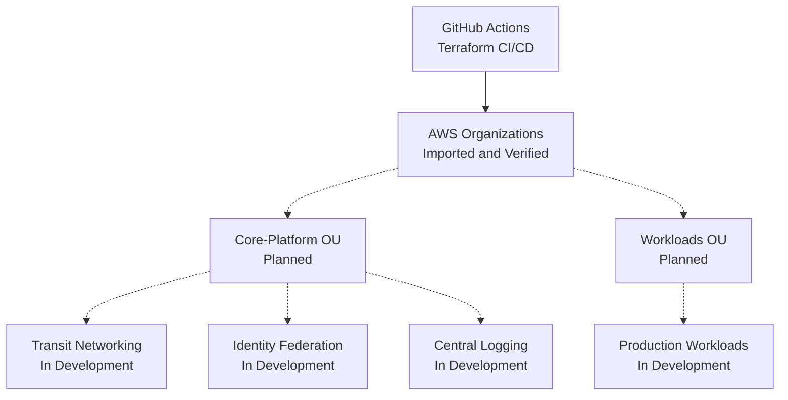

# AWS Secure Landing Zone — Architecture

## Infrastructure Architecture

## Implementation Status

**Verified**
- Existing AWS Organization imported into Terraform state
- Remote state backend and state locking configured
- GitHub Actions Terraform validation and planning
- Post-import plan confirms no configuration drift

**Planned / In Development**
- Organizational unit deployment
- Service Control Policies
- Transit networking
- Identity federation
- Centralized security logging
- Production workload infrastructure

## Design Principles

- Infrastructure as Code
- Least-privilege access
- Customer-owned AWS environments
- Explicit change review
- Secure-by-default configurations
- Reusable and configurable Terraform modules

> Dashed connections represent intended architecture,
> not deployed infrastructure.
